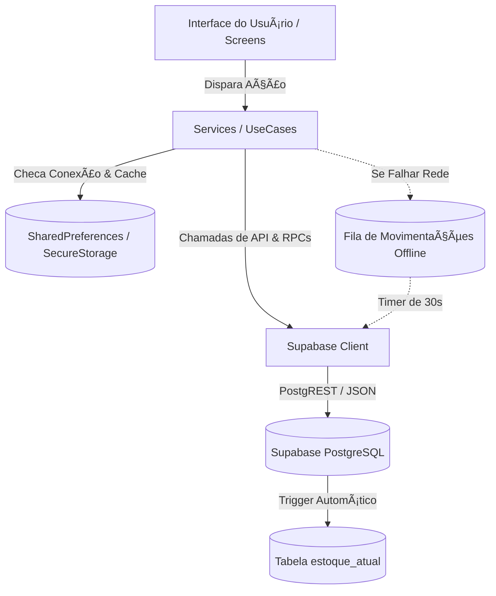

# 01 — ARQUITETURA ATUAL (FLUTTER / DART)

## 1. Mapeamento Estrutural do Código-Fonte
O projeto Flutter está estruturado no padrão modular orientado a camadas de domínio e componentes visuais, com aplicação de Clean Architecture no módulo de autenticação:

```text
lib/
├── core/                                    # Fundamentos globais e utilitários
│   ├── app_colors.dart                      # Design Tokens de cores institucionais
│   ├── app_routes.dart                      # Dicionário central de rotas de navegação
│   ├── app_theme.dart                       # Configuração de temas Material Design
│   ├── exceptions.dart                      # Classes de exceção de domínio (OfflineQueueException)
│   └── supabase_config.dart                 # Inicialização do client Supabase via .env
│
├── features/                                # Módulos estruturados em Clean Architecture
│   ├── auth/                                # Autenticação, gestão de dispositivos e segurança
│   │   ├── data/
│   │   │   ├── datasources/                 # auth_local_datasource.dart, auth_remote_datasource.dart
│   │   │   ├── models/                      # auth_result_model.dart, device_model.dart
│   │   │   └── repositories/                # auth_repository_impl.dart
│   │   ├── domain/
│   │   │   ├── entities/                    # session_info.dart
│   │   │   ├── repositories/                # auth_repository.dart
│   │   │   └── usecases/                    # login_usecase.dart, check_session_usecase.dart, biometric_login_usecase.dart
│   │   └── presentation/
│   │       ├── screens/                     # pending_device_screen.dart
│   │       └── widgets/                     # pin_keyboard.dart (teclado virtual)
│   │
│   └── onboarding/                          # Apresentação inicial do aplicativo
│       ├── data/                            # onboarding_data.dart (slides e benefícios)
│       └── presentation/
│           ├── screens/                     # onboarding_screen.dart
│           └── widgets/                     # onboarding_page.dart
│
├── models/                                  # Entidades e DTOs de dados
│   ├── funcionario_model.dart               # Modelo de Colaboradores e senhas
│   ├── inventario_model.dart                # Registro e cabeçalho de contagens
│   ├── movimentacao_model.dart              # Transações (EN, SA, DV, CONSUMO) e auditoria
│   ├── prateleira_model.dart                # Endereçamento físico e zonas
│   ├── produto_model.dart                   # Itens, saldos, estoque mínimo e conformidade
│   └── usuario_model.dart                   # Usuário administrativo
│
├── screens/                                 # Interfaces de usuário e controladores
│   ├── auth/                                # login_screen.dart
│   ├── estoque/                             # estoque_baixo_screen.dart
│   ├── home/                                # home_screen.dart
│   ├── inventario/                          # inventario_screen.dart
│   ├── localizacao/                         # localizacao_screen.dart
│   ├── movimentacao/                        # entrada_screen.dart, saida_screen.dart, devolucao_screen.dart, movimentacoes_screen.dart, nada_consta_screen.dart
│   ├── scanner/                             # scanner_screen.dart (leitor de código de barras/QR)
│   └── splash/                              # splash_screen.dart (decisão de roteamento inicial)
│
├── services/                                # Serviços de infraestrutura e regras de negócio
│   ├── auth_service.dart                    # Estado reativo da sessão, timeout e auditoria
│   ├── funcionario_service.dart             # Busca de crachá e RPCs de senhas
│   ├── inventario_service.dart              # Persistência de contagens físicas no Supabase
│   ├── movimentacao_service.dart            # Inserção e consulta de transações
│   ├── prateleira_service.dart              # Consulta de localizações físicas
│   ├── produto_service.dart                 # Consulta de produtos, estoque baixo e prateleiras
│   └── sync_service.dart                    # Fila offline e sincronização periódica (30s)
│
├── widgets/                                 # Componentes reutilizáveis
│   ├── alert_estoque_baixo.dart             # Card de alerta dinâmico
│   ├── quantity_selector.dart               # Incrementador/decrementador numérico
│   ├── stock_button.dart                    # Botão com loading state embutido
│   ├── stock_card.dart                      # Cartão com ícone para grid da Home
│   └── stock_input.dart                     # Campo de texto padronizado com ícones
│
└── main.dart                                # Ponto de entrada, injeção de dependências e rotas
```

---

## 2. Padrões Arquiteturais e Responsabilidades
1. **Clean Architecture (no módulo `auth`):**
   - **Domain:** Totalmente isolado de bibliotecas externas; declara casos de uso (`LoginUseCase`, `CheckSessionUseCase`, `BiometricLoginUseCase`), entidades puras (`SessionInfo`) e contratos abstratos de repositório (`AuthRepository`).
   - **Data:** Implementa fontes de dados locais (`FlutterSecureStorage`) e remotas (RPC Supabase `validar_login_funcionario`).
   - **Presentation:** Controladores reativos integrados à árvore de widgets com teclado virtual e telas especializadas.
2. **Provider Pattern (Injeção de Dependências e Estado):**
   - No arquivo `lib/main.dart`, um `MultiProvider` configura:
     - `SyncService` (ChangeNotifierProvider) com loop autônomo iniciado na montagem.
     - `AuthService` (ChangeNotifierProvider) controlando o ciclo de vida do usuário autenticado.
     - `ProxyProvider2` para injetar instâncias de `SyncService` e `AuthService` em `FuncionarioService`, `ProdutoService`, `MovimentacaoService`, `PrateleiraService` e `InventarioService`.
3. **Padrão Offline-First Híbrido:**
   - As consultas a produtos, prateleiras e funcionários tentam primeiro o Supabase; em caso de falha de conexão, recuperam o último snapshot salvo em cache local via `SharedPreferences`.
   - As escritas em `movimentacoes` interceptam erros de conexão disparando a exceção `OfflineQueueException`, que grava os dados na fila persistente `movimentacoes_offline` e exibe aviso em tela.

---

## 3. Camada Nativa e MethodChannels (Android)
No arquivo `android/app/src/main/kotlin/com/stockangel/stockangel_mobile/MainActivity.kt`, herdeiro de `FlutterFragmentActivity`:
1. **Canal de Áudio Industrial (`com.stockangel.app/beep`):**
   - Utiliza `android.media.ToneGenerator(AudioManager.STREAM_MUSIC, 100)` disparando `TONE_PROP_BEEP` por 150 milissegundos para gerar o som característico de coletores industriais ao ler códigos.
2. **Canal de Detecção de Segurança e Anti-Tamper (`com.stockangel.app/security`):**
   - Método `isRooted()`: Varre a presença física de binários `su` em 9 diretórios do sistema Android (`/sbin/su`, `/system/bin/su`, `/data/local/xbin/su`, etc.) e executa `Runtime.getRuntime().exec("which su")`.
   - Método `isEmulator()`: Inspeciona strings de hardware no `Build.FINGERPRINT`, `Build.MODEL`, `Build.MANUFACTURER` e `Build.DEVICE` procurando marcas como `generic`, `google_sdk`, `Genymotion`.
   - Método `isDeveloperModeEnabled()`: Consulta `Settings.Global.DEVELOPMENT_SETTINGS_ENABLED`.
   - Se qualquer um desses checks falhar, o app notifica o backend via log de segurança (`vulnerability_detected`) e pode restringir a execução.

---

## 4. Diagrama de Fluxo de Dados e Camadas


---

## 5. Requisitos para a Versão React Native
- Substituir o `Provider` por **Zustand** ou **Redux Toolkit**, garantindo store modular desacoplada da UI.
- Substituir `SharedPreferences` por **AsyncStorage** ou **MMKV** (alta performance).
- Substituir `FlutterSecureStorage` por **expo-secure-store** ou **react-native-keychain**.
- Reproduzir os canais de áudio e segurança através de bibliotecas Expo (`expo-av`, `expo-device`, `expo-application`, `expo-haptics`) ou TurboModules equivalentes.