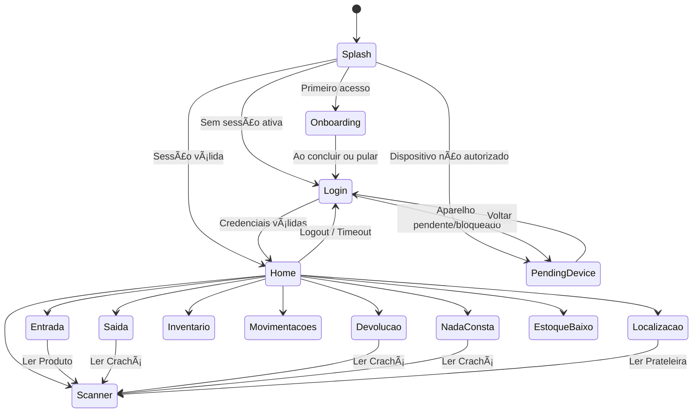

# 02 — TELAS E NAVEGAÇÃO DO APLICATIVO

## 1. Inventário Geral de Telas
O aplicativo possui exatamente **14 telas** implementadas:

| # | Identificador de Rota | Nome da Tela | Arquivo Dart de Origem | Objetivo Principal |
| :-: | :--- | :--- | :--- | :--- |
| 1 | `/` | SplashScreen | `lib/screens/splash/splash_screen.dart` | Decisão de fluxo inicial (Sessão / Onboarding / Login / Pendente) |
| 2 | `/onboarding` | OnboardingScreen | `lib/features/onboarding/presentation/screens/onboarding_screen.dart` | Apresentação institucional e benefícios do sistema |
| 3 | `/login` | LoginScreen | `lib/screens/auth/login_screen.dart` | Autenticação por Crachá e PIN de 6 dígitos com proteção contra força bruta |
| 4 | `/pending-device` | PendingDeviceScreen | `lib/features/auth/presentation/screens/pending_device_screen.dart` | Bloqueio e aviso de aparelho aguardando aprovação ou revogado |
| 5 | `/home` | HomeScreen | `lib/screens/home/home_screen.dart` | Dashboard operacional, atalhos, alerta de estoque baixo e status offline |
| 6 | `/scanner` | ScannerScreen | `lib/screens/scanner/scanner_screen.dart` | Leitura de código de barras e QR Code pela câmera com bipe sonoro |
| 7 | `/entrada` | EntradaScreen | `lib/screens/movimentacao/entrada_screen.dart` | Registro de entradas avulsas ou por conferência no estoque |
| 8 | `/saida` | SaidaScreen | `lib/screens/movimentacao/saida_screen.dart` | Saída avulsa ou consumo com carrinho em lote, validação de EPI e senha |
| 9 | `/devolucao` | DevolucaoScreen | `lib/screens/movimentacao/devolucao_screen.dart` | Retorno de materiais com listagem de pendências e assinatura por senha |
| 10 | `/movimentacoes` | MovimentacoesScreen | `lib/screens/movimentacao/movimentacoes_screen.dart` | Histórico recente de movimentações filtrável por tipo (EN, SA, DV) |
| 11 | `/nada-consta` | NadaConstaScreen | `lib/screens/movimentacao/nada_consta_screen.dart` | Consulta de pendências do colaborador e emissão de status de quitação |
| 12 | `/inventario` | InventarioScreen | `lib/screens/inventario/inventario_screen.dart` | Contagem física de estoque, reconciliação e troca de prateleira |
| 13 | `/estoque-baixo` | EstoqueBaixoScreen | `lib/screens/estoque/estoque_baixo_screen.dart` | Listagem urgente de itens com saldo igual ou inferior ao estoque mínimo |
| 14 | `/localizacao` | LocalizacaoScreen | `lib/screens/localizacao/localizacao_screen.dart` | Localizador bimodal: onde está o produto e o que tem na prateleira |

---

## 2. Detalhamento Físico de Cada Tela

### 2.1 SplashScreen (`/`)
- **Arquivo:** `lib/screens/splash/splash_screen.dart`
- **Objetivo:** Inicializar o aplicativo, aguardar 2 segundos e validar o estado do dispositivo e da sessão armazenada para decidir a tela de destino.
- **Componentes:** `Scaffold`, `Image.asset('assets/icon.png')`, `Text('ZOESTOCK')`, `CircularProgressIndicator`.
- **Campos de Entrada:** Nenhum.
- **Botões e Ações:** Nenhuma ação manual do usuário.
- **Validações e Lógica:**
  - Chama `authService.checkSession()`.
  - Se `devicePending` ou `deviceBlocked` -> Redireciona para `/pending-device`.
  - Se sessão válida (`user != null`) -> Redireciona para `/home`.
  - Se sem sessão -> Lê `onboarding_completed` no `FlutterSecureStorage`. Se `true`, vai para `/login`; caso contrário, vai para `/onboarding`.
- **Serviços Chamados:** `AuthService`, `FlutterSecureStorage`.
- **Tabelas Supabase:** Consulta indireta via RPC `validar_login_funcionario` (se houver validação de token).
- **Comportamento em React Native:** Hook `useEffect` que executa a checagem no carregamento inicial da Navigation Stack.

### 2.2 OnboardingScreen (`/onboarding`)
- **Arquivo:** `lib/features/onboarding/presentation/screens/onboarding_screen.dart`
- **Objetivo:** Guiar o novo usuário sobre as 4 propostas de valor do aplicativo através de um carrossel de slides.
- **Componentes:** `PageView.builder`, `AnimatedContainer` (indicadores de página), botão circular de avançar, botão "PULAR".
- **Campos de Entrada:** Nenhum.
- **Ações:** "PULAR" ou botão "COMEÇAR AGORA" no último slide grava `onboarding_completed = 'true'` no SecureStorage e navega para `/login`.
- **Dados:** Lista de 4 slides em `onboarding_data.dart` (Bem-vindo, Entradas e Saídas, Inventário em Tempo Real, Segurança em Primeiro Lugar).
- **Comportamento em React Native:** Utilizar `react-native-pager-view` ou `FlatList` horizontal com paginação nativa.

### 2.3 LoginScreen (`/login`)
- **Arquivo:** `lib/screens/auth/login_screen.dart`
- **Objetivo:** Autenticar o operador de estoque através do número do Crachá/Matrícula e do PIN de segurança de 6 dígitos.
- **Componentes:** `StockInput` (Crachá), seletor visual de 6 pontos para o PIN, teclado virtual na tela (`PinKeyboard`), indicador de bloqueio por força bruta com cronômetro regressivo.
- **Campos de Entrada:** `_crachaController` (Texto/Numérico), `_pin` (String de 6 dígitos alimentada pelo teclado customizado).
- **Botões e Ações:** Botão "Entrar" (`StockButton`), teclas 0-9, botão apagar e botão limpar do `PinKeyboard`.
- **Validações:**
  - Crachá não pode ser vazio.
  - O PIN deve ter exatamente 6 dígitos (`_pin.length == 6`).
  - Bloqueio de interface se o aparelho estiver temporariamente bloqueado por tentativas consecutivas incorretas.
- **Serviços Chamados:** `AuthService.login(cracha, pin)`.
- **Tabelas Supabase:** Executa RPC `validar_login_funcionario` com envio de metadados do aparelho e coordenadas GPS.
- **Comportamento em React Native:** Teclado numérico customizado em TypeScript com feedback tátil (`expo-haptics`).

### 2.4 PendingDeviceScreen (`/pending-device`)
- **Arquivo:** `lib/features/auth/presentation/screens/pending_device_screen.dart`
- **Objetivo:** Notificar o usuário que o aparelho físico atual está aguardando homologação do gestor ou foi bloqueado por motivos de segurança.
- **Componentes:** Ícone de escudo/bloqueio, texto explicativo, caixa com Device ID e modelo, botão "Verificar Aprovação", botão "Voltar ao Login".
- **Ações:**
  - "Verificar Aprovação": Revalida o status no backend via `checkSession()`. Se aprovado, vai para a `/home`.
  - "Voltar ao Login": Limpa a sessão local via `logout()` e retorna a `/login`.
- **Comportamento em React Native:** Exibição do UUID do aparelho capturado via `expo-application` / `expo-device`.

### 2.5 HomeScreen (`/home`)
- **Arquivo:** `lib/screens/home/home_screen.dart`
- **Objetivo:** Centro de comando do aplicativo. Apresenta saudação, nome da empresa vinculada, banner de sincronização offline, alerta de estoque baixo e atalhos para os módulos.
- **Componentes:**
  - `AppBar` com botões de recarga e logout.
  - Banner de advertência de itens pendentes de sincronização com botão de "Sincronizar Agora".
  - Saudação personalizada com crachá e nome da empresa.
  - Componente `AlertEstoqueBaixo` (banner pulsante se houver produtos críticos).
  - Grid com 8 `StockCard` (Entrada, Saída, Devolução, Inventário, Movimentações, Scanner, Localização, Nada Consta).
- **Regras e Temporizadores:**
  - Timer de verificação de sessão a cada 30 segundos (`_sessionTimer`). Se a sessão expirar por inatividade ou revogação, o usuário é deslogado automaticamente.
  - Carregamento de dados em segundo plano (`Future.microtask`) para preencher o cache de produtos, prateleiras e funcionários.
  - Listener de toque na tela (`onPointerDown`) que renova o carimbo de última interação do usuário.
- **Comportamento em React Native:** Dashboard com `ScrollView` e `FlatList` em grade com monitoramento de ciclo de vida do app (`AppState`).

### 2.6 ScannerScreen (`/scanner`)
- **Arquivo:** `lib/screens/scanner/scanner_screen.dart`
- **Objetivo:** Fornecer visor de câmera em tela cheia para leitura rápida de códigos de barras (EAN-13, CODE-128) e QR Codes.
- **Componentes:** Widget `MobileScanner`, mira centralizada desenhada com bordas vermelhas, botão de alternar lanterna (Torch).
- **Ações:** Ao capturar o código, dispara som de bipe industrial via MethodChannel `com.stockangel.app/beep`, vibra o celular (`HapticFeedback.lightImpact`) e fecha a tela retornando o valor em texto (`Navigator.pop(code)`).
- **Comportamento em React Native:** `expo-camera` ou `react-native-vision-camera` com áudio via `expo-av`.

### 2.7 EntradaScreen (`/entrada`)
- **Arquivo:** `lib/screens/movimentacao/entrada_screen.dart`
- **Objetivo:** Lançar entradas físicas de mercadorias no almoxarifado (reposições, compras avulsas ou acertos).
- **Componentes:** DropdownSearch com busca de produtos por nome ou código, seletor de quantidade (`QuantitySelector`), campo de observação, checkbox de ajuste de inventário, botão "Confirmar Entrada".
- **Regras:**
  - Quantidade deve ser obrigatoriamente maior que zero.
  - O produto é vinculado à prateleira cadastrada.
  - Registra a movimentação com tipo `EN`. O gatilho de banco `trg_update_estoque` soma a quantidade no saldo de `estoque_atual`.
- **Comportamento em React Native:** Modal de seleção pesquisável com `FlatList` virtualizada para alta performance.

### 2.8 SaidaScreen (`/saida`)
- **Arquivo:** `lib/screens/movimentacao/saida_screen.dart`
- **Objetivo:** Registrar saídas de materiais com máxima rastreabilidade, permitindo saídas em lote (carrinho), validação de EPI e exigência de senha do colaborador.
- **Componentes:**
  - Seletor de Funcionário com botão de escanear QR Code do crachá.
  - Card informativo com nome e setor do colaborador.
  - Multi-seleção de produtos via `DropdownSearch.multiSelection`.
  - Seletor de quantidade e campo de observação.
  - Checkbox "Consumo" (indica material descartável/consumível).
  - Lista de itens adicionados ao carrinho com opção de remoção individual.
  - Diálogo de validação de senha de 4 dígitos do colaborador (`_pedirSenhaMovimentacao`).
  - Diálogo de cadastro inicial de senha (`_criarSenhaMovimentacao`) caso o colaborador ainda não possua PIN.
  - Modal de advertência de bloqueio de EPI vencido (`_mostrarPopupBloqueado`).
- **Regras:**
  - Quantidade solicitada somada ao carrinho não pode ultrapassar o saldo atual em estoque.
  - Se o produto tiver conformidade (CA ou aferição) com `bloquear_vencido = true` e data vencida, o sistema bloqueia a inclusão no carrinho.
  - A saída gera movimentações com tipo `SA` (ou `CONSUMO`).
- **Comportamento em React Native:** Carrinho persistido em estado global (Zustand) com validações síncronas antes da confirmação.

### 2.9 DevolucaoScreen (`/devolucao`)
- **Arquivo:** `lib/screens/movimentacao/devolucao_screen.dart`
- **Objetivo:** Receber materiais de volta no estoque e dar baixa nas pendências do colaborador.
- **Componentes:**
  - Busca de colaborador por crachá ou escaneamento de QR Code.
  - Painel de pendências atuais do colaborador carregado dinamicamente via `getPendenciasFuncionario()`.
  - Reordenação automática da lista de produtos: os itens que o colaborador está devendo são posicionados no topo da lista.
  - Campo de quantidade devolvida e observação.
  - Diálogo de confirmação de detalhes e exigência de senha de 4 dígitos do colaborador.
- **Regras:** Gera movimentação com tipo `DV`, que através da trigger de banco incrementa o saldo físico em `estoque_atual`.

### 2.10 MovimentacoesScreen (`/movimentacoes`)
- **Arquivo:** `lib/screens/movimentacao/movimentacoes_screen.dart`
- **Objetivo:** Exibir a lista das últimas 50 movimentações realizadas pela empresa para conferência rápida pelo operador.
- **Componentes:** Barra de filtros com chips horizontais ("Todos", "Entrada", "Saída", "Devolução"), lista com cards estilizados por tipo (verde para EN, vermelho para SA, laranja para DV), indicador de data/hora formatada e nome do almoxarife.
- **Tabelas Supabase:** Consulta `movimentacoes` com embeds de `produtos(nome)` e `funcionarios(nome)`.

### 2.11 NadaConstaScreen (`/nada-consta`)
- **Arquivo:** `lib/screens/movimentacao/nada_consta_screen.dart`
- **Objetivo:** Consultar a situação fiscal de um colaborador para homologações de rescisão, transferências ou auditorias periódicas.
- **Componentes:** Campo de busca rápida por matrícula ou leitor de QR Code, cartão de dados do colaborador, painel de status centralizado.
- **Regras:**
  - Se o saldo pendente (Saídas - Devoluções) de todos os itens for zero -> Exibe selo verde "NADA CONSTA" (Colaborador não possui pendências).
  - Se houver saldo pendente -> Lista os itens em vermelho com a quantidade em débito (Ex: "Devendo: 2 UN").

### 2.12 InventarioScreen (`/inventario`)
- **Arquivo:** `lib/screens/inventario/inventario_screen.dart`
- **Objetivo:** Realizar a contagem física periódica de itens e regularizar discrepâncias de saldo e localização física.
- **Componentes:**
  - Seletor de produto com exibição do saldo registrado no sistema e prateleira atual.
  - Checkbox para habilitar transferência de prateleira física.
  - Seletor de prateleira destino.
  - Campo numérico para a quantidade física real encontrada.
  - Campo de observação da contagem.
- **Regras:**
  - Se houver mudança de prateleira: gera saída (`SA`) da prateleira antiga e entrada (`EN`) na nova prateleira com o novo saldo.
  - Se na mesma prateleira: calcula `diferenca = real - sistema`. Se positiva, lança `EN`; se negativa, lança `SA`.
  - Cria cabeçalho na tabela `inventarios` e item detalhado em `inventario_itens`.

### 2.13 EstoqueBaixoScreen (`/estoque-baixo`)
- **Arquivo:** `lib/screens/estoque/estoque_baixo_screen.dart`
- **Objetivo:** Apresentar em lista de prioridade máxima todos os produtos cujo estoque físico atingiu ou caiu abaixo do estoque mínimo de segurança.
- **Componentes:** Lista com cartões de alerta em tom vermelho claro, identificação do estoque atual vs estoque mínimo, localização da prateleira e chip "CRÍTICO".

### 2.14 LocalizacaoScreen (`/localizacao`)
- **Arquivo:** `lib/screens/localizacao/localizacao_screen.dart`
- **Objetivo:** Resolver a logística física do galpão através de duas visões (Abas):
  - **Aba 1 (Buscar Produto):** O operador escolhe o item e o app exibe a prateleira, zona e saldo atual.
  - **Aba 2 (Escanear/Buscar Prateleira):** O operador lê o código de barras da prateleira (ex: "A-01") ou seleciona da lista, e o app exibe todos os produtos estocados naquela posição física específica.

---

## 3. Mapa de Navegação do ZoeStock
