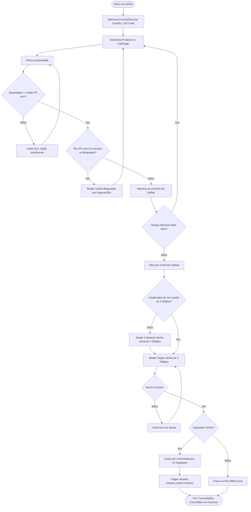

# 08 — MODELOS DE DADOS E FLUXOGRAMAS

## 1. Contratos de Dados em TypeScript (Modelos React Native)

```typescript
// Modelo de Produto e Conformidade de EPI
export interface ProdutoConformidade {
  tipo_controle: 'CA' | 'AFERICAO';
  data_validade?: string;
  data_proxima_afericao?: string;
  bloquear_vencido: boolean;
  controlar_por_unidade: boolean;
  status_manual?: 'LIBERADO' | 'BLOQUEADO';
  numero_ca?: string;
}

export interface ProdutoModel {
  id: string;
  codigo: string;              // codigo_barras no Supabase
  nome: string;
  categoria?: string;
  unidade?: string;            // unidade_medida no Supabase
  estoqueAtual: number;        // agregado via join da tabela estoque_atual
  estoqueMinimo: number;
  prateleiraId?: string;
  ativo: boolean;              // !excluido no Supabase
  consumo: boolean;
  conformidade?: ProdutoConformidade;
  caNumero?: string;
  ehEpi?: boolean;
}

// Modelo de Funcionário
export interface FuncionarioModel {
  id: string;
  cracha: string;
  nome: string;
  departamento?: string;
  ativo: boolean;
  empresaId?: string;
  empresaNome?: string;
  senhaMovimentacao?: string;  // hash SHA-256
}

// Modelo de Movimentação (Livro-Razão)
export interface MovimentacaoModel {
  id?: string;
  produtoId: string;
  funcionarioId?: string;
  prateleiraId?: string;
  tipo: 'EN' | 'SA' | 'DV' | 'CONSUMO';
  quantidade: number;
  observacao?: string;
  tipoEntrada?: string;
  createdAt?: string;
  nomeProduto?: string;
  nomeFuncionario?: string;
  usuarioNome?: string;
  usuarioMatricula?: string;
  deviceId?: string;
  appVersion?: string;
  osPlatform?: string;
  ipAddress?: string;
  latitude?: number;
  longitude?: number;
  sessionId?: string;
  empresaId?: string;
}

// Modelo de Prateleira (Endereçamento Físico)
export interface PrateleiraModel {
  id?: string;
  codigoLocalizacao: string;
  zona: string;
}

// Modelo de Inventário
export interface InventarioModel {
  id?: string;
  produtoId: string;
  usuarioId: string;
  quantidadeSistema: number;
  quantidadeReal: number;
  diferenca: number;
  observacao?: string;
  createdAt?: string;
}
```

---

## 2. Fluxograma Operacional: Saída de Mercadoria e Assinatura
